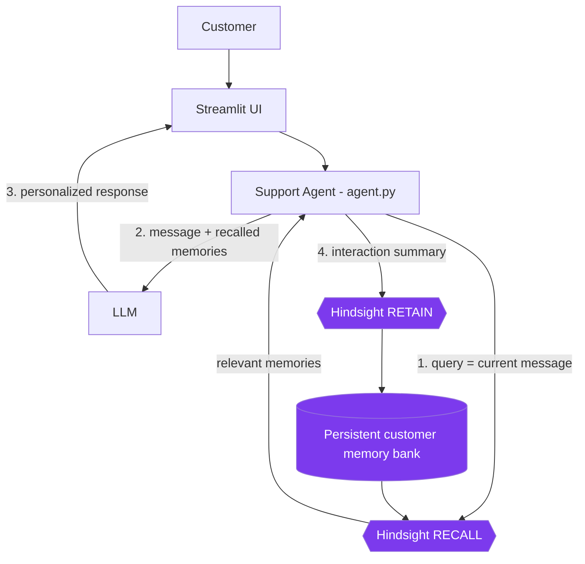

# Support Memory Agent

A customer-support agent that uses Hindsight persistent memory to recall past tickets, so returning customers don't have to repeat themselves.

## Problem

Support agents (human or AI) usually know what is in the *current* conversation. The trouble starts when the customer comes back a week later and says "my payment is failing again." Without history, the agent asks the same questions again: which device, what error, what did you already try? Customers get frustrated and resolution takes longer.

## Solution

Every customer message goes through a fixed loop: **recall** relevant memories from Hindsight, give them to the LLM along with the current message, reply, then **retain** the interaction. Each customer has their own Hindsight memory bank, so the next conversation starts from what actually happened before.

## Why Hindsight?

A chat transcript only lives as long as the session, and stuffing every past ticket into a prompt does not scale or stay relevant. This project needs memory that:

- persists across sessions and days,
- is retrieved by relevance to the *current* message, not dumped wholesale,
- is written back after every interaction.

Hindsight's `retain` and `recall` operations are the memory layer here. There is no dictionary, JSON file or in-app "memory" variable standing in for it. If Hindsight is down, the UI says so instead of pretending.

## How Memory Works

```
Customer message
      ↓
Hindsight RECALL  (bank: support-<customer-id>-<run-id>)
      ↓
Relevant memories
      ↓
LLM support agent  (current message + recalled memories)
      ↓
Response
      ↓
Hindsight RETAIN  (interaction is written back)
```

## Before vs After

Same LLM, same message, same customer. The only difference is whether recalled Hindsight context is included in the prompt (the **Before vs After** tab runs both).

| | Without memory (baseline) | With Hindsight |
|---|---|---|
| Customer | "My payment is failing again." | "My payment is failing again." |
| LLM context | CRM profile only | CRM profile + recalled memories of the earlier Android payment ticket |
| Expected behavior | Asks for device and what happened | Refers to the earlier Android issue and starts from the fix that worked before (clear app cache, retry) |

The exact wording of replies comes from the LLM and varies between runs. Capture your own screenshots.

## Architecture



## Features

- Support chat for one selected customer with an LLM agent
- Real Hindsight `recall` before each reply and `retain` after each reply
- Per-message trace under each reply: recall status and retain status
- Memory panel showing the exact memories recalled and passed to the LLM
- "Without memory" baseline mode (recall is skipped, nothing is retained)
- Side-by-side **Before vs After** tab (recall once, answer twice, retain nothing)
- "Retain resolution" button to store a confirmed fix for a ticket
- Sample customer histories loadable into Hindsight (login, delivery, refund tickets)
- Graceful errors for: Hindsight unavailable, LLM failure, empty recall, failed retain, empty message

## Tech Stack

Python, Streamlit, Hindsight (`hindsight-client`), Anthropic or OpenAI LLM API.

## Project Structure

```
app.py          Streamlit UI (chat, memory panel, before/after tab)
agent.py        LLM call: current message + recalled memory -> reply
memory.py       Hindsight wrapper: retain(), recall(), health check, prompt/retain formatting
prompts.py      Support-agent system prompt and user-prompt builder
demo_data.py    Synthetic CRM profiles and past tickets
content/        Article, LinkedIn post, video script, demo script, architecture notes
screenshots/    Put your real screenshots here
```

## Setup

```bash
python -m venv .venv
source .venv/bin/activate        # Windows: .venv\Scripts\activate
pip install -r requirements.txt
cp .env.example .env             # then fill in your keys
```

Start Hindsight (see the Hindsight docs for the current local run instructions, or use Hindsight Cloud) and confirm it answers at `HINDSIGHT_BASE_URL`.

## Environment Variables

| Variable | Purpose |
|---|---|
| `HINDSIGHT_BASE_URL` | Hindsight API URL (default `http://localhost:8888`; use your hosted URL for Cloud) |
| `HINDSIGHT_API_KEY` | Only needed for hosted Hindsight |
| `DEMO_RUN_ID` | Suffix for memory bank names. Change it for fully empty memory |
| `LLM_PROVIDER` | `anthropic` or `openai` |
| `LLM_MODEL` | Model name for the chosen provider |
| `ANTHROPIC_API_KEY` / `OPENAI_API_KEY` | Key for the chosen provider |

`.env` is git-ignored. Never commit real keys.

## Running the App

```bash
streamlit run app.py
```

## Demo Scenario

1. Select **Priya Sharma** (Android app). Click **Start a fresh demo run** so her memory is empty.
2. Send: `My payment is failing whenever I use the Android app.` The agent troubleshoots; the trace shows recall found nothing and the interaction was retained.
3. Reply as the customer: `I cleared the cache and restarted the app, and the payment went through.` Then click **Retain resolution**.
4. Start the later interaction and send: `My payment is failing again.` (Use the **Before vs After** tab to see both versions.)
5. The memory panel shows what Hindsight recalled, and the reply builds on the earlier Android fix.

## Limitations

- Not yet run end to end by the author of this file against a live Hindsight server; verify the flow yourself before submitting (see checklist in the final hand-off).
- Hindsight client method signatures were written from the public client API and may need small adjustments for your installed version.
- The interaction that is retained includes the agent's own suggestion, which may not have solved the problem. Only the explicit resolution note (or the customer saying it worked) marks a fix as confirmed.
- The Environment field in the memory panel comes from the CRM profile, not from Hindsight. Recalled memories are shown as returned.
- Frustration level is not tracked as a separate field; it is only present if it appears in retained text.
- Demo data is synthetic, there is no authentication, and the LLM's exact phrasing is not deterministic.

## Future Improvements

- Structured extraction of environment, issue type and outcome per ticket
- Confirm-resolution prompt built into the chat instead of a sidebar button
- Escalation summary for human agents using recalled history
- Automated tests around recall/retain with a local Hindsight instance
- Staleness handling (e.g. app version changed since the last ticket)

## Hindsight Resources

- Hindsight GitHub: https://github.com/vectorize-io/hindsight
- Hindsight documentation: https://hindsight.vectorize.io/
- Vectorize agent memory: https://vectorize.io/what-is-agent-memory
